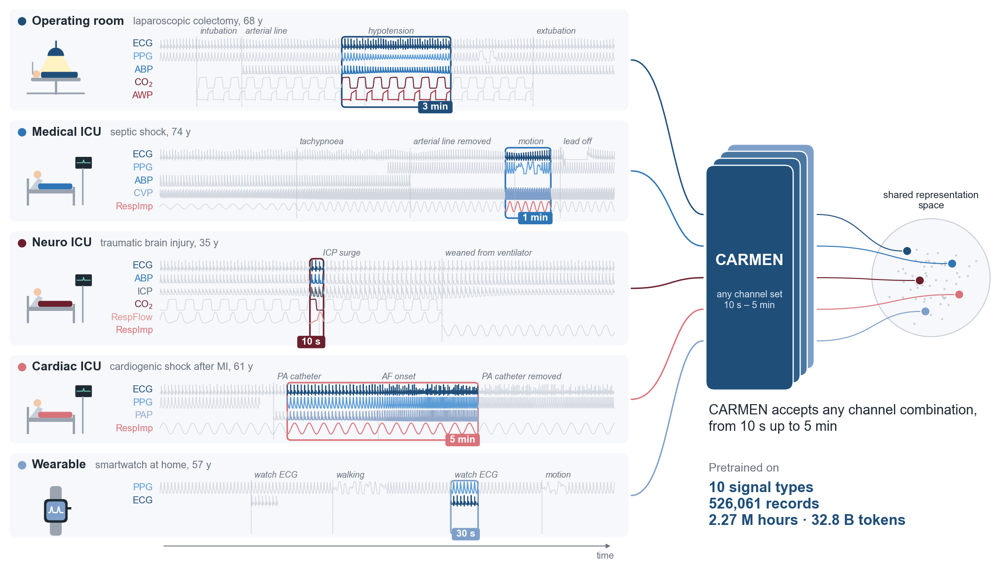

# CARMEN

### A Cardiorespiratory Foundation Model Pretrained on Ten Physiological Signals for Perioperative and Critical Care

[](https://arxiv.org/pdf/2611.15004)
[](LICENSE)
[](https://www.python.org/)
[](https://pytorch.org/)
[](#-overview)
[](https://huggingface.co/dlcjfgmlnasa28/CARMEN)
[](#-model-weights)

[**Paper (arXiv)**](https://arxiv.org/pdf/2611.15004) · [**Quickstart Notebook**](examples/quickstart.ipynb) · [**Examples**](examples) · [**Inference API**](#-inference-api) · [**Model Weights**](https://huggingface.co/dlcjfgmlnasa28/CARMEN)

## 📰 News

- **2026.11** — The CARMEN paper is now available on **[arXiv](https://arxiv.org/pdf/2611.15004)**. 📄
- **2026.10** — CARMEN has been accepted to the **[GenAI4Health Workshop at NeurIPS 2026](https://genai4health.github.io/2026-NeurIPS/)**. 🎉

## 📖 Overview

<p align="center">
  
</p>

**CARMEN** is a multimodal foundation model for the cardiorespiratory waveforms recorded
in the operating room and intensive care unit. Most existing biosignal foundation models
are limited to non-invasive signals such as ECG and PPG. CARMEN learns **10 signal
modalities**, including invasive haemodynamic and respiratory waveforms (arterial, central
venous and pulmonary arterial pressure, capnography, airway pressure and flow), in a
**single Transformer encoder**. It keeps each signal's absolute physical units and accepts
any combination of signals at variable input lengths.

CARMEN was pretrained on about 530,000 perioperative and ICU waveform recordings from
Seoul National University Hospital (2.27 million modality-hours in total). It is released
in three sizes (**Small 52M · Base 174M · Large 410M**) and is used as a frozen **feature
extractor**: for each downstream clinical task (detection, prediction, outcome, estimation
and phenotyping), only a lightweight head is trained on top.

> [!WARNING]
> **Research use only.** CARMEN is not a medical device and has not been cleared or
> approved for clinical use. Do not use its outputs for diagnosis or to guide patient
> care.

## 📐 Input Requirements

CARMEN conditions on the **absolute level** of each signal (PPG and RESP_Impedance
excepted), so inputs must be in the units used during pretraining. A signal in the
wrong unit will run without error but produce degraded features.

| `signal_type` | Modality | `make_batch` key | Expected unit |
| :-: | --- | --- | --- |
| 0 | ECG | `"ecg"` | mV |
| 1 | ABP | `"abp"` | mmHg |
| 2 | PPG | `"ppg"` | arbitrary (device-dependent; absolute level is not used) |
| 3 | CVP | `"cvp"` | mmHg |
| 4 | CO2 | `"co2"` | mmHg (convert vol% × 7.13) |
| 5 | AWP | `"awp"` | cmH₂O (convert hPa × 1.0197) |
| 6 | ICP | `"icp"` | mmHg |
| 7 | RESP_Impedance | `"resp_impedance"` | arbitrary (device-dependent; absolute level is not used) |
| 8 | RESP_Flow | `"resp_flow"` | L/min |
| 9 | PAP | `"pap"` | mmHg |

The authoritative mappings are `carmen.SIGNAL_TYPE_NAMES` (type → name) and
`carmen.SIGNAL_KEY_TO_TYPE` (`make_batch` key → type).

> [!IMPORTANT]
> CARMEN is pretrained at **100 Hz** with a patch size of **25 samples (0.25 s/token)**.
> Resample your signals to 100 Hz before use.

> [!IMPORTANT]
> **Inputs must be finite.** A single `NaN` turns every feature of that sample into
> `NaN`, without an error. Fill gaps before packing (for example with 0), and optionally
> pass the gap positions as `extract_features(batch, gap_mask_patch=...)` — a
> `(B, N)` bool mask — so those patches are replaced by the learned [MASK] token.

## 🚀 Quick Start

### 📦 Installation

```bash
git clone https://github.com/dlcjfgmlnasa/CARMEN.git && cd CARMEN
pip install -e .              # or: pip install -r requirements.txt
```

Requires Python ≥ 3.10, PyTorch ≥ 2.2, einops ≥ 0.7.

### ✅ Verify the install (no weights needed)

```bash
python examples/00_smoke_test.py
```

This builds the model from a config with random weights and runs a forward pass, so it
needs no downloaded weights.

### 🧠 Model weights

> [!NOTE]
> The pretrained weights will be made **publicly available upon acceptance of the paper**
> on the Hugging Face Hub at
> [**dlcjfgmlnasa28/CARMEN**](https://huggingface.co/dlcjfgmlnasa28/CARMEN). If you already
> have a checkpoint file, see
> [Using a local checkpoint](#using-a-local-checkpoint).

CARMEN comes in three sizes. They share the input pipeline (10 modalities, 100 Hz,
0.25 s patches, same conditioning) and pretraining recipe; only width and depth differ.

| Model | Params | `d_model` | Layers | Heads | File | Size (fp32) |
| --- | --: | --: | --: | --: | --- | --: |
| CARMEN-Small | 52M | 512 | 16 | 8 | `carmen-small.pt` | ~210 MB |
| **CARMEN-Base** | **174M** | 768 | 24 | 12 | `carmen-base.pt` | ~700 MB |
| CARMEN-Large | 410M | 1024 | 32 | 16 | `carmen-large.pt` | ~1.6 GB |

The examples default to **Base**. Pass a model name instead of a path: CARMEN first looks
for `checkpoints/<name>.pt`, and otherwise downloads the weights from the Hub and caches
them (needs `pip install -e ".[hf]"`):

```python
model = CARMEN.from_pretrained("carmen-base")          # or "carmen-small" / "carmen-large"
wrapper = DownstreamModelWrapper("carmen-base", device="cuda")
```

Or download the file yourself into `checkpoints/` (weights are *not* committed to git;
see [`checkpoints/README.md`](checkpoints/README.md)):

```bash
huggingface-cli download dlcjfgmlnasa28/CARMEN carmen-base.pt --local-dir checkpoints
```

#### Using a local checkpoint

If you already have a checkpoint file (e.g. `carmen-base.pt`), you can also use it
directly — no Hugging Face account or internet connection needed. Put it in
`checkpoints/` and load it by name, so the examples run unchanged:

```python
model = CARMEN.from_pretrained("carmen-base")          # loads checkpoints/carmen-base.pt
```

Or pass its path from anywhere:

```python
model = CARMEN.from_pretrained("path/to/carmen-base.pt")
wrapper = DownstreamModelWrapper("path/to/carmen-base.pt", device="cuda")
```

Each checkpoint embeds its own `ModelConfig`, so the architecture is reconstructed
automatically — you never specify it by hand.

### ✨ Extracting features

```python
import torch
from carmen import DownstreamModelWrapper, make_batch

# 1. Load the pretrained encoder (frozen, eval mode)
wrapper = DownstreamModelWrapper("checkpoints/carmen-base.pt", device="cpu")

# 2. Pack raw 1-D signals (100 Hz) into a batch — one patient, multiple modalities
t = torch.linspace(0, 30, 3000)
batch = make_batch(
    [("ecg", torch.sin(2*torch.pi*1.2*t)),
     ("ppg", torch.sin(2*torch.pi*1.2*t - 0.6)),
     ("abp", 80 + 30*torch.sin(2*torch.pi*1.2*t - 0.3))],
    patch_size=wrapper.patch_size,
)

# 3. One feature vector per patient
features = wrapper.extract_features(batch)   # (B, d_model)
```

> [!WARNING]
> **Pass equal-length signals.** With the default `collate_mode="any_variate"`,
> `PackCollate` trims a patient's signals to one common length so they pair up. When
> the inputs differ in length, that length is drawn at random, and a signal shorter
> than the drawn length is **dropped** from the batch (as is any signal shorter than
> 5 patches = 1.25 s), so features can change between runs. `make_batch` warns when it
> drops a signal. For reproducible results, pass equal-length signals, call
> `random.seed(0)` before building the batch, or use `collate_mode="ci"`.

> [!IMPORTANT]
> **One feature per signal: set `max_length`.** `extract_features` mean-pools each
> *row* of the batch, and by default `make_batch` packs every signal into a single
> row. Even with `collate_mode="ci"` (attention blocked between signals) you then get
> **one** feature averaged over all signals. To get one feature per signal — e.g. per
> lead of a 12-lead ECG, or many recordings in one batch — set `max_length` to the
> signal length so each signal fills its own row:
>
> ```python
> leads = [("ecg", ecg[:, j]) for j in range(12)]          # 12 × 1,000 samples (10 s @ 100 Hz)
> batch = make_batch(leads, patch_size=wrapper.patch_size, collate_mode="ci", max_length=1000)
> features = wrapper.extract_features(batch)               # (12, d_model), same as 12 separate calls
> ```
>
> Use equal-length signals whose length is a multiple of `patch_size`.

## 🧩 Inference API

`CARMEN.from_pretrained(path)` returns the bare encoder; `DownstreamModelWrapper` adds
loading, freezing, pooling and LoRA on top. `batch` below is what `make_batch` returns.

```python
from carmen import CARMEN, DownstreamModelWrapper

model   = CARMEN.from_pretrained("checkpoints/carmen-base.pt")                  # bare encoder
wrapper = DownstreamModelWrapper("checkpoints/carmen-base.pt", device="cuda")   # + freeze / pool / LoRA

# ── Representations ──────────────────────────────────────────────────────
feats = wrapper.extract_features(batch)                 # (B, d_model)      pooled, frozen
feats = wrapper.extract_features(batch, pool="none")    # (B, N, d_model)   per patch
enc   = model.extract_features(batch)                   # dict of raw encoder outputs

# ── Adaptation ───────────────────────────────────────────────────────────
wrapper.inject_lora(rank=8)                             # LoRA on q_proj / v_proj
# extract_features runs without gradients; to train the adapters, call
# wrapper.model(batch, task="masked") and pool "encoded" yourself
# (see examples/02_downstream_probe.py)

# ── Finer tokens from the same weights ───────────────────────────────────
fine = DownstreamModelWrapper("checkpoints/carmen-base.pt", patch_stride=5)
                                                        # overlapping patches; RoPE positions
                                                        # are rescaled to physical spacing
```

**Feeding your own data**

`make_batch` covers the common case. For full control, build one `BiosignalSample` per
channel and collate them with `PackCollate`:

```python
from carmen import BiosignalSample, PackCollate, CHANNEL_NAME_TO_SIGNAL_TYPE

sample = BiosignalSample(
    values=ecg,                 # 1-D tensor @ 100 Hz
    length=ecg.numel(),
    channel_idx=0, recording_idx=0, n_channels=1, win_start=0,
    sampling_rate=100.0,
    signal_type=CHANNEL_NAME_TO_SIGNAL_TYPE["ECG II"],   # -> 0
    session_id="patient-001",   # samples sharing a session are packed together
    start_sample=0,
)
batch = PackCollate(max_length=8192, patch_size=25)([sample])
```

`collate_mode="any_variate"` (default) groups a patient's modalities into one row so
the encoder can attend across them; `collate_mode="ci"` blocks attention between
signals. In both modes signals are packed into rows of `max_length` samples, and
pooling is per row — see the note on `max_length` above.

## 🔬 Examples

📓 **[`quickstart.ipynb`](examples/quickstart.ipynb)** — end to end: build → features → pretrained weights

- **[`00_smoke_test.py`](examples/00_smoke_test.py)** — build from config and run a forward pass, no weights needed
- **[`01_extract_features.py`](examples/01_extract_features.py)** — load a checkpoint, extract pooled features *(downloads weights)*
- **[`02_downstream_probe.py`](examples/02_downstream_probe.py)** — linear probe and LoRA on frozen features *(downloads weights)*
- **[`03_vitaldb_arrhythmia.py`](examples/03_vitaldb_arrhythmia.py)** — real data: 4-class rhythm classification from intraoperative ECG *(downloads weights and open data)*

```bash
python examples/00_smoke_test.py
python examples/01_extract_features.py               # downloads carmen-base from the Hub
python examples/01_extract_features.py carmen-large  # or another model name / a local .pt path
```

### 🫀 Real data: arrhythmia on VitalDB

`03_vitaldb_arrhythmia.py` uses open data only — rhythm labels from the
[VitalDB Arrhythmia Database](https://physionet.org/content/vitaldb-arrhythmia/1.0.0/)
(PhysioNet, CC BY 4.0) and the matching ECG lead II from [VitalDB](https://vitaldb.net).
It cuts 30 s windows whose beats all share one rhythm, in four classes — normal sinus
rhythm (NSR), atrial fibrillation/flutter (AF), ventricular arrhythmia (VA: VT, patterned
ventricular ectopy) and bradyarrhythmia/conduction block (BradyCond: AVB, SND). CARMEN
stays frozen and a logistic regression is fit on the pooled features, training on half
the patients and testing on the other half.

```bash
pip install vitaldb scikit-learn
python examples/03_vitaldb_arrhythmia.py
```

Default run (150 cases → 2,812 windows from 147 patients; test set 1,408 windows from
73 held-out patients — NSR 966, AF 257, VA 44, BradyCond 141):

| Test AUROC (one-vs-rest) | Macro | NSR | AF | VA | BradyCond |
| --- | --: | --: | --: | --: | --: |
| CARMEN-Base | 0.967 | 0.965 | 1.000 | 0.989 | 0.913 |

This is a demo that the released weights work on real waveforms, not the paper protocol
(482 cases, patient-level 5-fold CV). VA has only 59 windows in this run (VT rarely lasts
a full 30 s), so its AUROC is noisy. VitalDB comes from the same hospital as part of the
pretraining corpus, and this demo does not remove patients that may also be in it (the
paper's evaluation does). Numbers move with `--cases-per-class` and `--seed`; downloads
take a few minutes.

## 🗂️ Repository Layout

```
carmen/
├── model.py         CARMEN encoder + inference API
├── config.py        ModelConfig (embedded in every checkpoint)
├── checkpoint.py    checkpoint save / load
├── wrapper.py       DownstreamModelWrapper (load / freeze / LoRA), LinearProbe
├── batch.py         make_batch / to_device — raw signals -> PackedBatch
├── data/            PackCollate (bin-packing), BiosignalSample, signal-type maps
└── modules/         attention (GQA), GLU FFN, RMSNorm / LSCNorm, patch embedding,
                     packed scalers, RoPE / attention bias
examples/            runnable examples + quickstart notebook
checkpoints/         put downloaded weights here (gitignored)
```

## 🙏 Acknowledgements

This research was supported by a grant of the Korea Health Technology R&D Project
through the Korea Health Industry Development Institute (KHIDI), funded by the Ministry
of Health & Welfare, Republic of Korea (grant number: RS-2024-00439677; NTIS number:
2460003917).

## 📜 Citation

```bibtex
@article{carmen2026,
  title         = {A Cardiorespiratory Foundation Model Pretrained on Ten Physiological Signals for Perioperative and Critical Care},
  author        = {Lee, Cheol-Hui and Kim, Wookyung and Lee, Hyeonhoon and Lee, Garam and Eun, Da-in and Lee, Hyung-Chul},
  journal       = {arXiv preprint arXiv:2611.15004},
  year          = {2026},
  eprint        = {2611.15004},
  archivePrefix = {arXiv},
  url           = {https://arxiv.org/abs/2611.15004}
}
```

## ⚖️ License

Released under the [PolyForm Noncommercial License 1.0.0](LICENSE): free for research,
education, personal and other noncommercial use. Commercial use (including use in
commercial products or services) requires a separate license — please contact
**dlcjfgmlnasa28@gmail.com** or **vital@snu.ac.kr**.

The model weights on Hugging Face are covered by the same terms. Files ported from
Salesforce uni2ts remain under the [Apache License 2.0](LICENSES/Apache-2.0.txt);
see [NOTICE](NOTICE).
